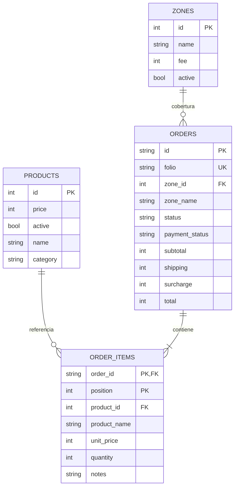
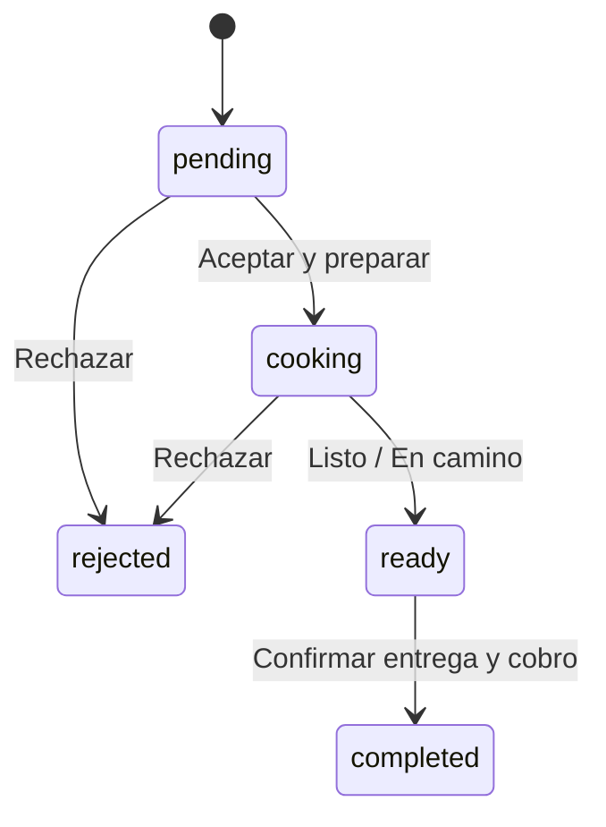

# Arquitectura

## Capas y archivos

```text
src/
  main.jsx                 Shell, navegación entre las tres vistas, SSE y errores
  api.js                   Cliente HTTP, dinero, estados y fechas locales
  style.css                Tailwind + estilos de componentes y breakpoints
  components/Cart.jsx      Carrito, entrega, pago, checkout y seguimiento
  views/Shop.jsx           Catálogo y presentación de marca
  views/Kitchen.jsx        KDS cronológico y transiciones de pedido
  views/Admin.jsx          Precios, disponibilidad, colonias y métricas
server/
  index.js                 HTTP, autorización, validación y publicación SSE
  domain.js                Cálculo monetario y máquina de estados
  store.js                 Persistencia transaccional y carga SQLite
  schema.sql               Tablas, restricciones, relaciones e índice
  payments.js              Checkout Pro, firma de webhook y consulta de pagos
public/                    Manifest, service worker, icono y recursos locales
tests/                     Pruebas de dominio, firma y API con SQLite temporal
data/                      Estado persistente local, fuera del control de versiones
```

Un mismo origen sirve React y `/api`, evitando CORS y separando los secretos de la compilación del navegador. Las mutaciones publican una señal SSE sin datos personales; cada vista vuelve a consultar únicamente los endpoints que tiene autorizados. SSE se reconecta automáticamente. El seguimiento se recupera al abrir la app con el UUID guardado en localStorage.

## Modelo relacional implementado



Todos los importes son enteros en centavos MXN. Cada línea captura nombre, precio unitario, cantidad y notas al comprar. El pedido captura el nombre de la colonia y el importe de envío para preservar su historia, mientras `zone_id` mantiene la relación aunque se renombre. El folio legible es independiente del UUID de seguimiento. Las restricciones exactas están en `server/schema.sql`.

Se usa SQLite WAL, claves foráneas y transacciones `BEGIN IMMEDIATE`. La instancia carga su estado en memoria; cada cambio lo persiste transaccionalmente. Es apropiado para esta base de una sola instancia y volumen bajo. Para crecer: repositorios con consultas por entidad, paginación, PostgreSQL y eventos compartidos mediante Redis; no levantar varias instancias que mantengan cachés independientes.

## Estados



`ready` se presenta al cliente como **En camino** en delivery y **Listo para recoger** en takeout. El estado financiero es independiente: `unpaid`, `paid`, `refunded`, `charged_back`. Efectivo se marca cobrado al completar la entrega; Mercado Pago solo mediante webhook verificado. Rechazar no devuelve dinero ni emite cupones automáticamente.

## API

| Método / ruta                 | Acceso               | Propósito                                      |
| ----------------------------- | -------------------- | ---------------------------------------------- |
| GET /api/catalog              | Público              | Productos, cobertura y capacidades del entorno |
| GET /api/events               | Público              | Señales SSE, sin contenido de los pedidos      |
| POST /api/orders              | Público              | Validar checkout, recalcular y crear pedido    |
| GET /api/orders/:uuid         | UUID de seguimiento  | Pedido concreto y su estado                    |
| GET /api/staff/orders         | Personal             | Lista para cocina y métricas                   |
| PATCH /api/staff/orders/:uuid | Personal             | Transición de estado válida                    |
| PATCH /api/staff/products/:id | Personal             | Precio y disponibilidad                        |
| POST /api/staff/zones         | Personal             | Alta de colonia                                |
| PATCH /api/staff/zones/:id    | Personal             | Nombre, tarifa o activación                    |
| POST /api/payments/webhook    | HMAC de Mercado Pago | Confirmar y actualizar estado financiero       |

`POST /api/orders`: `{name, phone, delivery: 'pickup'|'delivery', zoneId?, address?, payment: 'cash'|'mp', items: [{id, quantity, notes?}]}`. La respuesta incluye UUID, folio, estado, importes y, en pagos digitales configurados, `checkoutUrl`. Los precios proporcionados por el navegador no se usan.

La API exige `Authorization: Bearer STAFF_TOKEN` fuera del demo local. No es un sistema multiusuario: la separación de roles y la auditoría quedan pendientes para producción. Limitar el acceso público al entorno de desarrollo.

## Validación

`npm test` ejecuta pruebas de importes, redondeo, disponibilidad, transiciones, HMAC y una prueba integrada con servidor y base temporal. La prueba API verifica bloqueo de personal sin token, checkout, flujo cocina, cobro, conservación de precios históricos, rechazo de agotados y persistencia al reiniciar. No requiere credenciales de Mercado Pago ni modifica la base de desarrollo.
